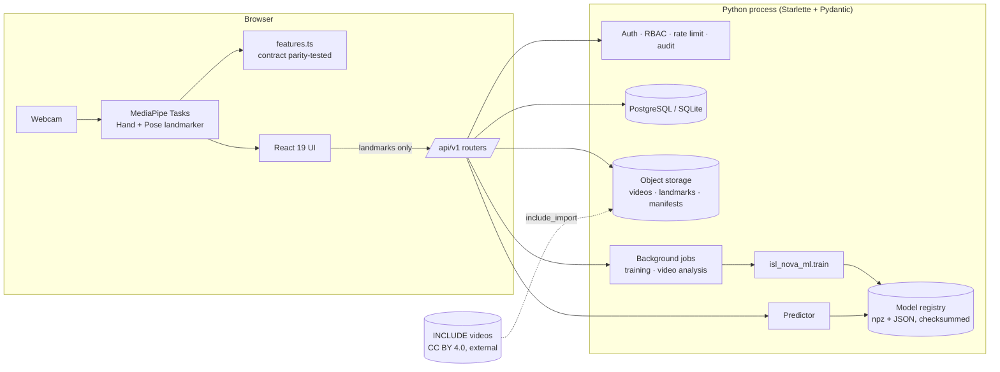
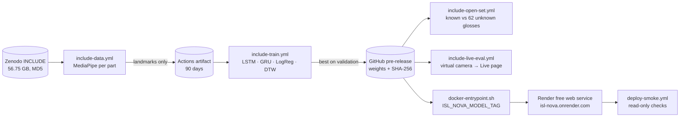

# Architecture

ISL NOVA is a **modular monolith**: one Python process serves the JSON API and the built web client. A shared ML package implements the feature contract, training and inference.

## Modules

| Layer | Path | Responsibility |
|---|---|---|
| Routing framework | `backend/app/api.py` | Declarative routes with Pydantic body/query models, auth mode, permission and rate bucket; generates OpenAPI from the same declarations |
| Core | `routers/core.py` | health, register/login, profile, notifications, admin users/roles, audit log |
| Vocabulary | `routers/signs.py` | sign CRUD (soft delete), verification state machine, translations, references, bookmarks, readiness computation |
| Dataset Lab | `routers/dataset.py` | stats, signers, consent, sessions, uploads with validation, annotations (four-eyes), validation, versioned manifests |
| AI Lab | `routers/ml.py` | model info/metrics, inference, evaluation, registry promote/rollback, experiments and background training |
| Personal | `routers/personal.py` | history, feedback, lessons, quiz, progress, phrases, video-analysis jobs, dashboard |
| Data access | `db.py`, `migrate.py`, `migrations/*.sql` | SQLite/PostgreSQL abstraction; versioned, checksummed migrations |
| Services | `services.py` | storage adapter (path-safe), upload sniffing/probing, audit, seeding, model service, job pool |
| ML | `ml/isl_nova_ml/` | `contract`, `features`, `models`, `data`, `augment`, `metrics`, `train`, `registry`, `inference`, `extract`, `include_import`, `synthetic`, `smoke` |
| Web client | `frontend/src/` | pages per module, design system (`components/ui.tsx`), SVG charts, camera pipeline, router/query/store |

## Key flows

**Live recognition.** The camera frame goes to MediaPipe in the browser, which produces landmarks. The page keeps a rolling buffer of these. A capture window (1.5, 2.5 or 3.5 s; default 2.5 s) or a continuous 2-second sliding window (at least 8 frames, every 750 ms) is posted to `POST /predict/sequence`. The server extracts features with the contract, runs the calibrated model, applies τ/margin and returns a state with the top-5 classes. Video never leaves the device.

**Data lifecycle.** Signer and consent are recorded first, then a session is opened. A recording is uploaded and validated, landing in `pending_review`. Someone annotates it and a second reviewer approves it. The class readiness is recomputed. Approved, consented recordings are frozen into a dataset version with a signer-independent split. That version feeds an experiment, the experiment registers a model, and an admin can promote it after reviewing its held-out metrics.

**Lineage.** `model.json` records the contract version, dataset version, manifest SHA-256, split counts, the recording IDs per split, any skipped or excluded recordings, and the leakage report. The registry verifies the weights' SHA-256 at load time.

## Model lifecycle and evaluation (GitHub Actions)

* Raw video never leaves the runner and is never committed; only landmarks
  (`.npz`) move between stages.
* Each stage is manual: you push a `run/*` branch, and its settings live in
  `ml/runs/*.json`. Nothing expensive runs on its own schedule.
* The container installs a release only through `scripts/fetch_model.py`. That
  script checks the SHA-256, extracts paths safely, verifies the model's
  integrity, registers it, and promotes it (synthetic models cannot be
  promoted).
* At run time the browser extracts landmarks with MediaPipe Tasks, falling back
  from GPU to CPU. It sends the captured landmark frames (never video) to
  `POST /api/v1/predict/sequence`. The server resamples them to the 32 × 204
  feature contract used in training, runs the calibrated model, and applies
  the τ/margin decision.
