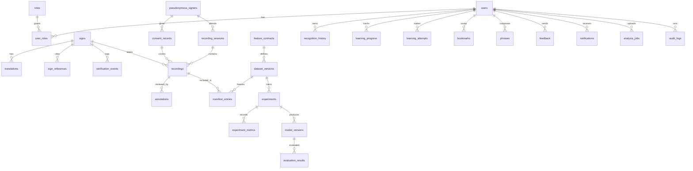

# Database schema

Source of truth: `backend/app/migrations/0001_core.sql` (portable tokens rendered per dialect). Print the PostgreSQL DDL with `PYTHONPATH=backend:ml python -m app.migrate --render postgresql`. All timestamps are UTC (`TIMESTAMPTZ` on PostgreSQL); JSON is `JSONB`. Videos are never stored in the database, only object-storage keys.

| Table | Purpose | Notable constraints / indexes |
|---|---|---|
| `users`, `roles`, `user_roles` | accounts and RBAC | unique email |
| `signs` | 200+ vocabulary entries | CHECK on verification_status and data_readiness; idx category, status |
| `translations` | en/hi/kn meanings | UNIQUE(sign_id, language); CHECK status |
| `sign_references` | licensed sources per sign | |
| `verification_events` | append-only review log | |
| `pseudonymous_signers` | random code + minimal profile | unique code |
| `consent_records` | scopes (JSON), retention, revocation | |
| `recording_sessions` | environment per session | |
| `recordings` | object keys, sha256, probe data, quality, status | CHECK status; idx sign, status, session, sha256 |
| `annotations` | labels + four-eyes decision | CHECK decision |
| `feature_contracts` | contract definitions | |
| `dataset_versions`, `manifest_entries` | immutable versions, per-recording split | UNIQUE(version), UNIQUE(version_id, recording_id); CHECK split |
| `experiments`, `experiment_metrics` | configs, logs, metrics | CHECK status |
| `model_versions`, `evaluation_results` | registry mirror | |
| `recognition_history`, `learning_progress`, `learning_attempts`, `bookmarks`, `phrases`, `feedback`, `notifications` | user features | FKs with CASCADE on user deletion |
| `analysis_jobs` | uploaded-video jobs with expiry | |
| `audit_logs` | accountability | idx created_at |
| `schema_migrations` | applied versions + checksums | |

PostgreSQL verification: the rendered schema was applied to PostgreSQL 16.15 with `psql -v ON_ERROR_STOP=1` (28 tables). Every distinct statement executed by the backend test suite (163) passed `PREPARE` against it.
